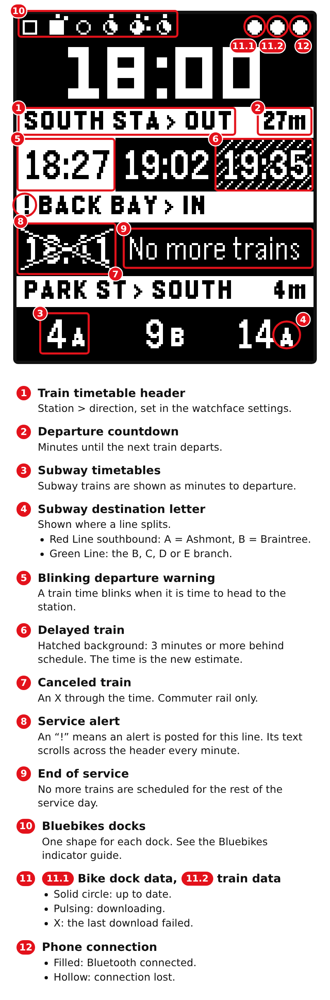
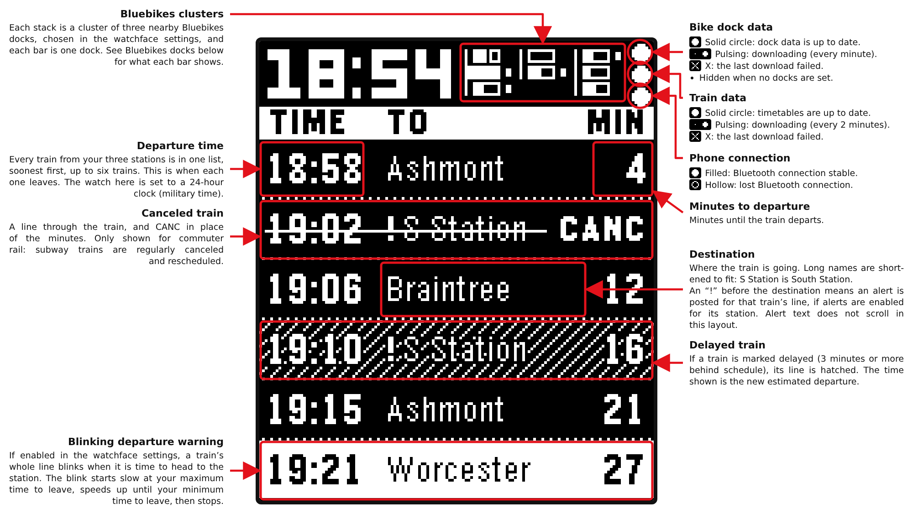
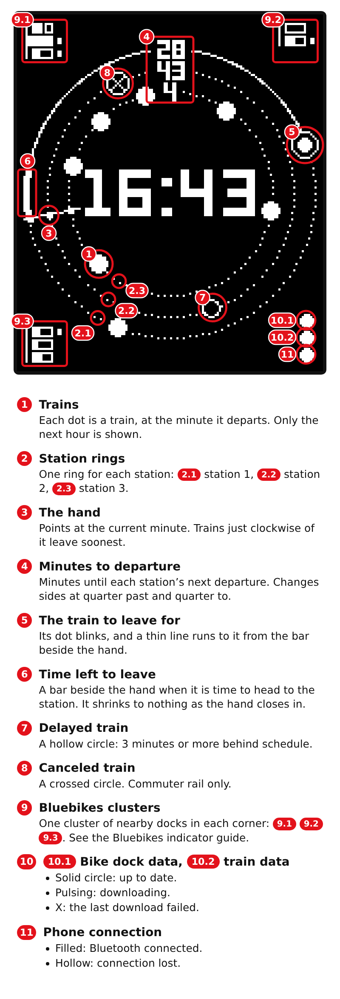
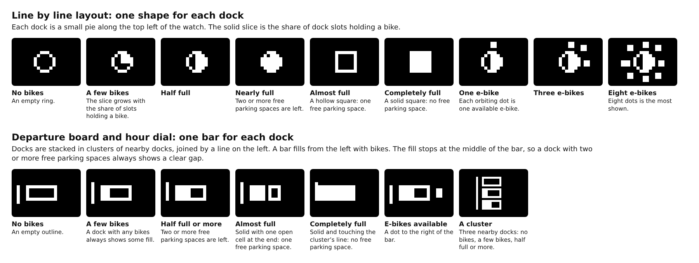
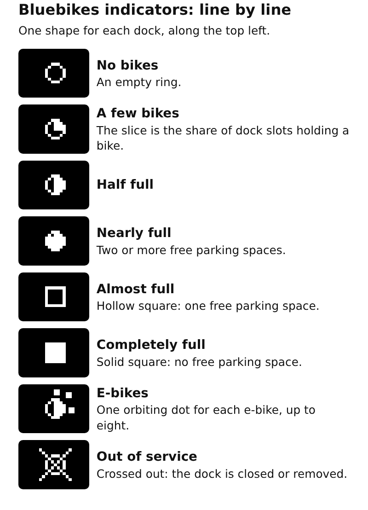
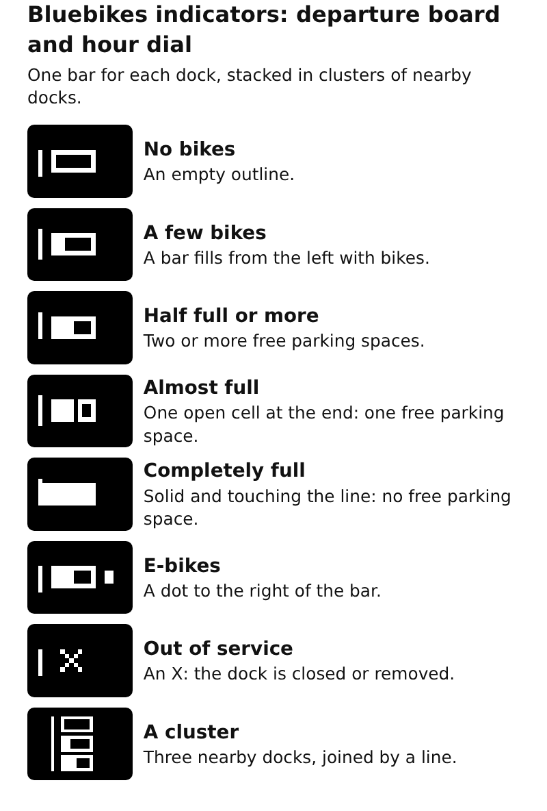

# MBTA Pebble


A Black and white Pebble watchface(diorite / flint) for your boston commute that shows the time plus live MBTA
departures, fetched from the [MBTA v3 API](https://api-v3.mbta.com) by PebbleKit JS (`src/pkjs/index.js`). It watches up to three stations or bus stops. Covers all currently published subway, light rail, commuter rail or bus line + direction + station. Select up to 9 bluebike Docks to see their live status, fetched from the [Bluebike GBFS Feed](https://bluebikes.com/system-data)

## Display features


<details>
<summary>Reading on a phone? Open the narrow version of this guide.</summary>



</details>

The line by line view shows the most information within a relatively fixed layout making quick glances easy to read. text size can be adjusted by changing the number of rows, allowing you to strike a ballance between readability and information availability.

This example uses 24 hour time (military). Commuter rail rows show departure times. Subway rows show minutes until each train, tagged with the first letter of its destination when trains in that direction go to different places (e.g. `A` = Ashmont, `B` = Braintree).

The Green Line is offered as a single line covering the B, C, D and E branches. Its stations are grouped into the shared central stops and each branch's own stops, and departures are tagged with their branch letter (e.g. `12B 15D`) wherever more than one branch stops.

Commuter rail times are scheduled times, replaced by live predictions when the MBTA has them. A cancelled train stays at its scheduled time, crossed out; a train at least 3 minutes late gets a hatched background. The watch requests fresh data every 2 minutes; set `MBTA_API_KEY` in `src/pkjs/index.js` for a higher rate limit.

### Layouts

The watchface settings offer three layouts.

- **Line by line**: The layout in the guide above. It shows one row per station, focusing on verbose schedule info.
- **Departure board**: This layout shows every upcoming train from all three stations in one list, soonest first, with its destination and the minutes until it leaves.
- **Hour dial**: one ring per station, outermost first. Each train of the next hour sits at the minute it departs, 

#### Departure board



<details>
<summary>Reading on a phone? Open the narrow version of this guide.</summary>


</details>

#### Hour dial


<details>
<summary>Reading on a phone? Open the narrow version of this guide.</summary>



</details>

Both screens use demo data so that every marker appears at once.

Service alerts only scroll in the line by line layout. The departure board marks a
train with `!` when its row has an alert; the hour dial does not show alerts.
If the watch restarts within ten minutes of switching to one of the newer
layouts, it goes back to line by line by itself.

### Bluebikes docks

Up to nine [Bluebikes](https://bluebikes.com/system-data) docks can be shown. since often bluebike docks are clustered in high traffic areas like north station, I've layed out the indicators as groups of 3. Dock status comes from the Bluebikes GBFS feed and refreshes every minute; the feed has no per-station query, so each refresh downloads the whole system's status (about
235 KB).



<details>
<summary>Reading on a phone? Open the narrow version: line by line.</summary>



</details>

<details>
<summary>Narrow version: departure board and hour dial.</summary>



</details>

The line by line layout is the original pie chart concept. After some live testing, the readability suffers, so a bar layout was developed. 

### Settings

The settings page is built with [Clay](https://github.com/pebble-dev/clay), defined
in `src/pkjs/config.js`). You can access it from the Pebble app by clicking on the watchface, or in the emulator with
`pebble emu-app-config --emulator diorite`.

#### Settings options

- **Layout**: changes watchface layout when saved to selected option
- **Trains shown per station** | ***Line by Line layout only:*** (1–5, default 3). When displaying 4 or 5 the text shrinks to fit and the clock gets the freed-up space.
- **Line → Direction → Station** Configure watched Stations. Leave any at None if you want fewer than three. The page loads these lists live from the MBTA API (`src/pkjs/config-page.js`): picking a line fills in its directions and stations.
- **Buses** are at the end of the Line list, by route number. For a bus the third picker is called **Stop**, and its list changes with the direction, because a bus stops on opposite sides of the street in each direction. The watch shows the buses the MBTA is predicting, which reaches about an hour ahead, so a route that runs rarely can show one bus or none.
  - Some bus routes split and end in different places. Where they do, each bus is tagged with the first letter of its destination, and the Direction list offers each destination on its own (e.g. "Outbound → Waltham Center only").
  - Known limit: the last stop of a route is offered in the Stop list but never shows a bus, because buses only arrive there and the watch shows departures.
- **Timetable header** for each station: the name shown above its trains. It is filled in programmatically (e.g. `PARK ST > SOUTH`) when you pick a station or direction, and you can edit it. For a bus it is the route number and where the bus is heading (e.g. `66 > HARVARD SQ`), since stop names are long. If it doesn't fit next to the countdown, the watch shortens the station part.
- **Show service alerts** for each station (off by default). When the MBTA has an alert in effect for that line, station and direction, an `!` marks the station. ***Line by Line layout only:*** the alert text also scrolls across the header every minute. The hour dial does not show alerts. Minor notices  (severity below 3) are left out. If the watch ever resets during a scroll, alerts stay off until the settings are saved again.
- **Blinking departure warning** to motivate you to leave for your train a blinking warning for each station: a train blinks when it is time to head to the station. The blink starts slow at your **maximum time to leave**, speeds up until your **minimum time to leave**, then stops. It is off by default;
- **Bluebikes docks**: nine slots in three clusters, each with a search box. Click on a dock in the Bluebike app to see it's official name. Then Type part of a dock's name into the and pick it from the list beneath.

## Building & running

`make` lists shortcuts for the commands below (`make emu`, `make shot`,
`make watch`, ...).

```sh
pebble build                          # build for all targetPlatforms
pebble install --emulator emery       # install on the emery emulator
pebble install --phone <ip>           # install to a paired phone
```

## Target platforms

`targetPlatforms` in `package.json` controls which watches you build for. The modern Pebble hardware is **emery** (Pebble Time 2), **gabbro** (Pebble Round 2), and **flint** (Pebble 2 Duo); the original Pebble platforms (aplite, basalt, chalk, diorite) are included by default for backwards compatibility.

## Project layout

```
src/c/           C source for the watchapp
src/pkjs/        PebbleKit JS (phone-side) source, if any
worker_src/c/    Background worker source, if any
resources/       Images, fonts, and other bundled resources
package.json     Project metadata (UUID, platforms, resources, message keys)
wscript          Build rules — usually no need to edit
```

By default this project is configured as a watchapp. To make it a watchface, set `pebble.watchapp.watchface` to `true` in `package.json`.

## Documentation

Full SDK docs, tutorials, and API reference: <https://developer.repebble.com>
