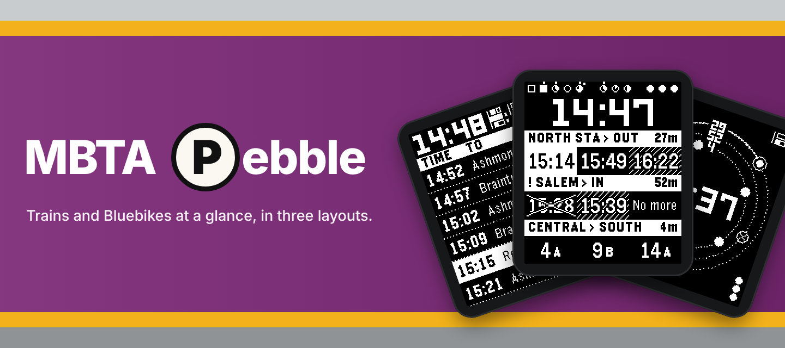
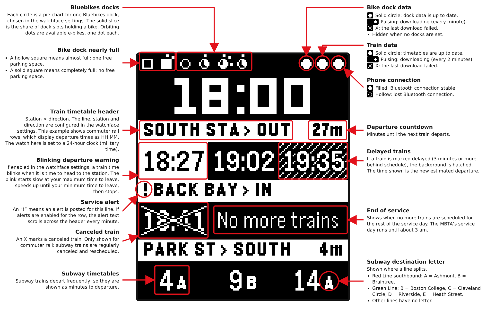
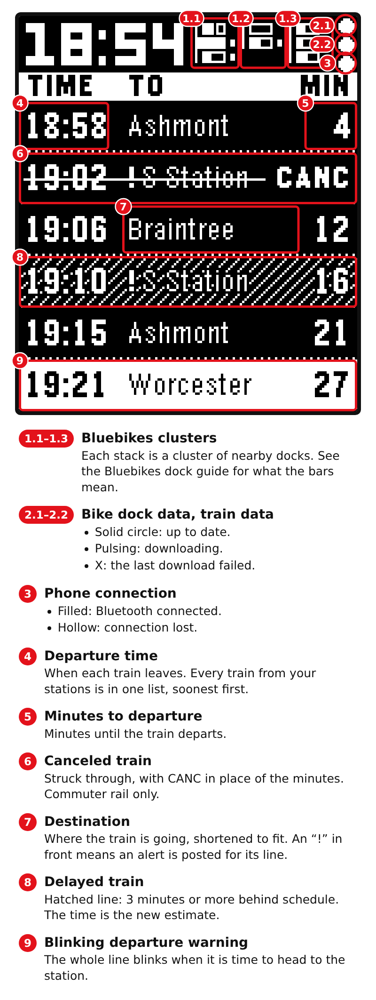
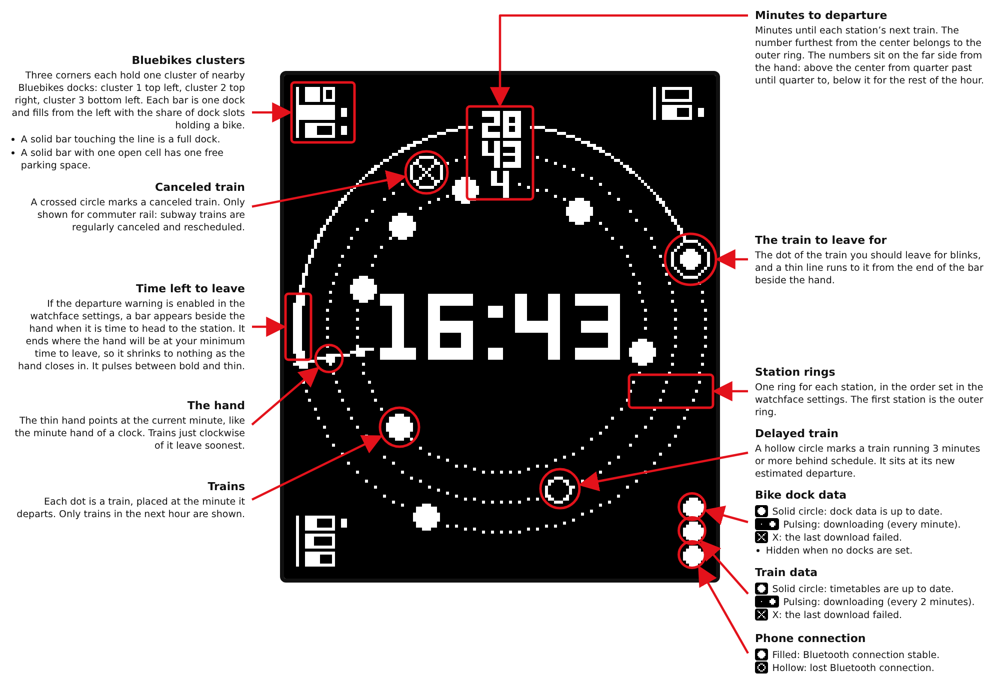

# MBTA Pebble



A Pebble watchface (diorite / flint) that shows the time plus live MBTA
departures, fetched from the [MBTA v3 API](https://api-v3.mbta.com) by
PebbleKit JS (`src/pkjs/index.js`). It watches up to three stations or bus stops, each one
any subway, light rail, commuter rail or bus line + direction + station.

No stations are set when the watchface is first installed. The watch shows
"Set up on phone" until you choose them in the watchface settings in the
Pebble app.



<details>
<summary>Reading on a phone? Open the narrow version of this guide.</summary>


</details>

The screen above uses demo data and example stations so that every marker
appears at once.

Commuter rail rows show departure times. Subway and bus rows show minutes
until each departure. A subway train is tagged with the first letter of its
destination when trains in that direction go to different places (e.g. `A` =
Ashmont, `B` = Braintree).

The Green Line is offered as a single line covering the B, C, D and E branches.
Its stations are grouped into the shared central stops and each branch's own
stops, and departures are tagged with their branch letter (e.g. `12B 15D`)
wherever more than one branch stops.

### Layouts

The watchface settings offer three layouts.

- **Line by line**: the layout in the guide above, one row per station.
- **Departure board**: every upcoming train from all three stations in one
  list, soonest first, with its destination and the minutes until it leaves.
  A train inside its row's warning range blinks as a whole line, a canceled
  train is struck through and a delayed train has a hatched line.
- **Hour dial**: one ring per station, outermost first. Each train of the next
  hour sits at the minute it departs, like the tip of a minute hand, and a thin
  hand points at the current minute. A canceled train is a crossed circle, a
  delayed train a hollow circle. While a train is inside its row's warning
  range, its marker blinks, and a bar that runs along the ring from the hand to
  the point where the range ends pulses between bold and thin, shrinking as
  the hand closes in. A thin solid line carries on from there to the train.
  The minutes until each ring's next departure are written in a
  gap in the ring, for commuter rail and subway alike. The numbers sit on
  the far side from the hand: below the centre from quarter to until quarter
  past, above it for the rest of the hour.

#### Departure board


<details>
<summary>Reading on a phone? Open the narrow version of this guide.</summary>



</details>

#### Hour dial



<details>
<summary>Reading on a phone? Open the narrow version of this guide.</summary>


</details>

Both screens use demo data so that every marker appears at once.

Service alerts only scroll in the line by line layout. The departure board marks a
train with `!` when its row has an alert; the hour dial does not show alerts.
If the watch restarts within ten minutes of switching to one of the newer
layouts, it goes back to line by line by itself.

### Bluebikes docks

Up to nine [Bluebikes](https://bluebikes.com/system-data) docks can be shown,
in three clusters of up to three docks that are near each other. Dock status
comes from the Bluebikes GBFS feed and refreshes every minute; the feed has no
per-station query, so each refresh downloads the whole system's status (about
235 KB).


A dock that is out of service, or that Bluebikes has removed, is crossed out:
a ring with an X through it in the line by line layout, and an X in place of
its bar in the other layouts.

In the line by line layout the docks are small circles along the top left, in the
order they are set. Each circle fills like a pie with the share of the dock's
spaces that hold a rentable bike (an empty ring means no bikes). The shape
turns square when there is almost nowhere to return a bike: a hollow square
for one free space, a solid square for none. Each available e-bike (up to
eight) is a small dot around the shape.

In the other layouts each cluster is a stack of bars joined by a line on the
left. A bar fills from the left with the share of spaces holding a bike. A
full dock is a solid bar that reaches back to touch the line. A dock with one
free space is solid with one open cell at its right end. Any dock with two or
more free spaces keeps a clear gap at the right, and a dot to the right of a
bar means e-bikes are available.

### Connection dots

Three dots sit at the top right. From left to right they are the bike docks'
data, the trains' data and the phone connection. A data dot is solid when its
data is up to date, pulses while downloading (bike docks every minute,
timetables every 2 minutes) and turns into an X when the last download failed.
The bike dot is hidden when no docks are set. The phone dot is filled while
Bluetooth is connected and hollow when the connection is lost.

### Settings

Open the settings page (via [Clay](https://github.com/pebble-dev/clay), defined
in `src/pkjs/config.js`) from the Pebble app, or in the emulator with
`pebble emu-app-config --emulator diorite`.

- **Layout**: line by line, departure board or hour dial.
- **Trains shown per station** (1–5, default 3), for the line by line layout.
  Each station's trains stay on one line; with 4 or 5 the text shrinks to fit
  and the clock gets the freed-up space.
- **Line → Direction → Station** for each of the three stations. Each starts
  at None; leave one at None if you want fewer than three. The page loads these
  lists live from the MBTA API (`src/pkjs/config-page.js`): picking a line
  fills in its directions and stations. If the MBTA can't be reached, the saved
  choices are still shown.
- **Buses** are at the end of the Line list, by route number. For a bus the
  third picker is called **Stop**, and its list changes with the direction,
  because a bus stops on opposite sides of the street in each direction. The
  watch shows the buses the MBTA is predicting, which reaches about an hour
  ahead, so a route that runs rarely can show one bus or none.
  - Some bus routes split and end in different places. Where they do, each bus
    is tagged with the first letter of its destination, and the Direction list
    offers each destination on its own (e.g. "Outbound → Waltham Center only").
  - Known limit: the last stop of a route is offered in the Stop list but never
    shows a bus, because buses only arrive there and the watch shows
    departures.
- **Timetable header** for each station: the name shown above its trains. It
  is filled in (e.g. `PARK ST > SOUTH`) when you pick a station or direction, and
  you can edit it. For a bus it is the route number and where the bus is
  heading (e.g. `66 > HARVARD SQ`), since stop names are long. If it doesn't fit next to the countdown, the watch shortens
  the station part.
- **Show service alerts** for each station (off by default). When the MBTA has
  an alert in effect for that line, station and direction, an `!` marks the
  station. In the line by line layout the alert text also scrolls across the
  header every minute. The hour dial does not show alerts. Minor notices
  (severity below 3) are left out. If the watch ever resets during a scroll,
  alerts stay off until the settings are saved again.
- **Blinking departure warning** for each station: a train blinks when it is
  time to head to the station. The blink starts slow at your **maximum time to
  leave**, speeds up until your **minimum time to leave**, then stops.
  It is off by default; when switched on it starts at 10 → 5 minutes.
- **Bluebikes docks**: nine slots in three clusters, each with a search box.
  Type part of a dock's name and pick it from the list beneath.

Commuter rail times are scheduled times, replaced by live predictions when
the MBTA has them. A cancelled train stays at its scheduled time, crossed
out; a train at least 3 minutes late gets a hatched background. The watch requests fresh data
every 2 minutes; set `MBTA_API_KEY` in `src/pkjs/index.js` for a higher
rate limit.

## Building & running

`make` lists shortcuts for the commands below (`make emu`, `make shot`,
`make watch`, ...).

```sh
pebble build                          # build for all targetPlatforms
pebble install --emulator emery       # install on the emery emulator
pebble install --phone <ip>           # install to a paired phone
```

## Target platforms

`targetPlatforms` in `package.json` controls which watches you build for. The
modern Pebble hardware is **emery** (Pebble Time 2), **gabbro** (Pebble Round
2), and **flint** (Pebble 2 Duo); the original Pebble platforms (aplite,
basalt, chalk, diorite) are included by default for backwards compatibility.

## Project layout

```
src/c/           C source for the watchapp
src/pkjs/        PebbleKit JS (phone-side) source, if any
worker_src/c/    Background worker source, if any
resources/       Images, fonts, and other bundled resources
package.json     Project metadata (UUID, platforms, resources, message keys)
wscript          Build rules — usually no need to edit
```

By default this project is configured as a watchapp. To make it a watchface,
set `pebble.watchapp.watchface` to `true` in `package.json`.

## Documentation

Full SDK docs, tutorials, and API reference: <https://developer.repebble.com>
